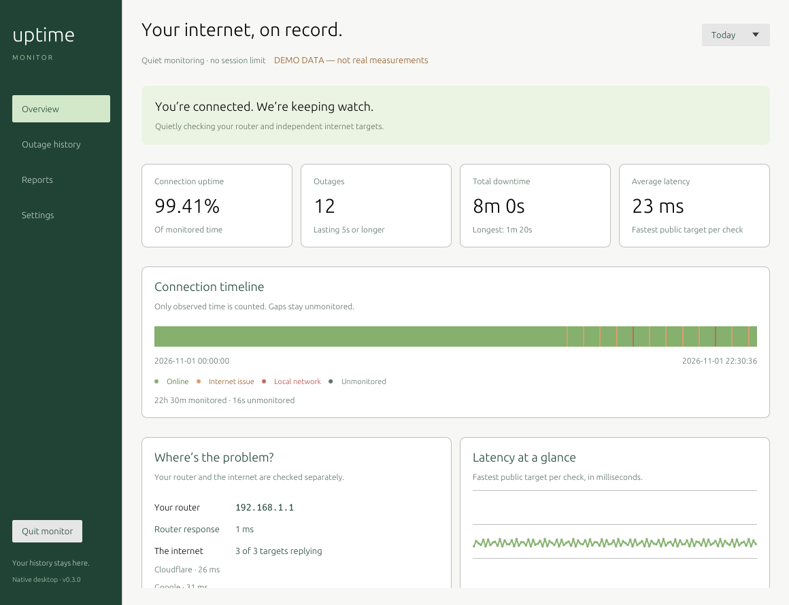
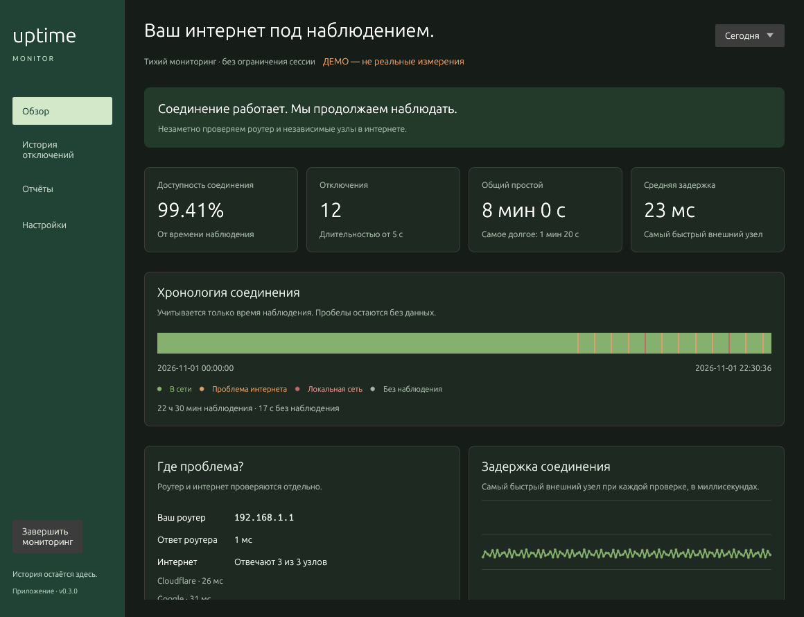
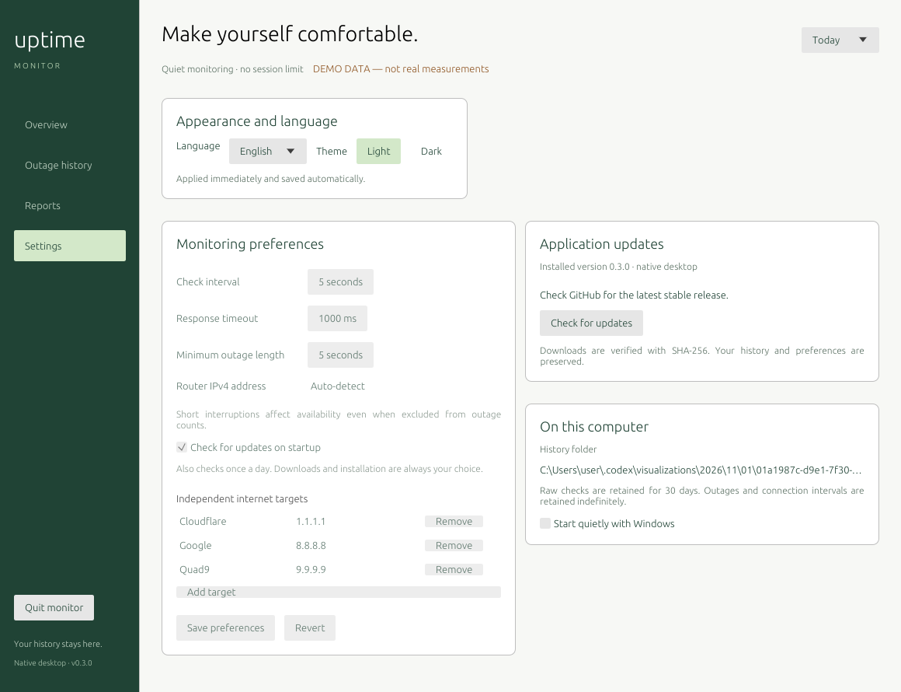
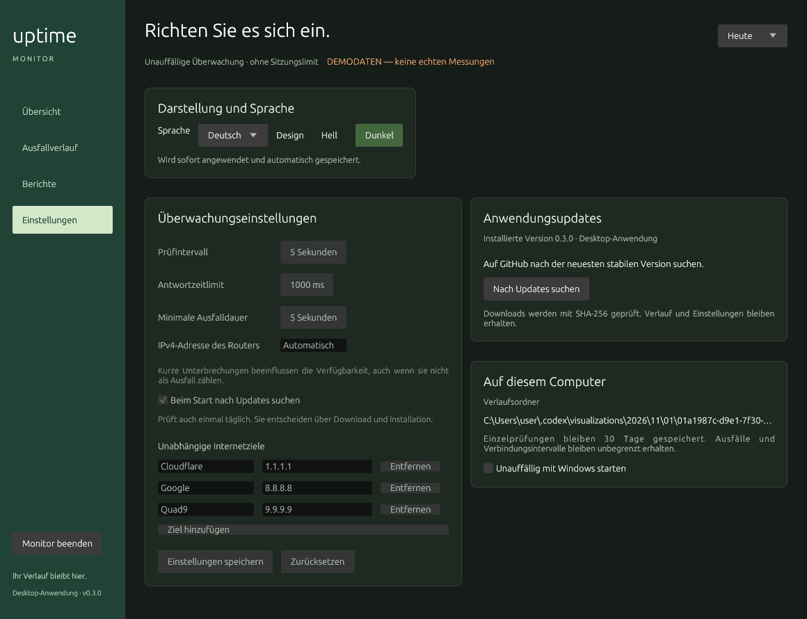

# Internet Uptime Monitor

**Show when your internet actually went down.**

A native Rust desktop app that quietly records connection interruptions, checks
your router separately from the internet, and produces a clear report:
**“12 outages. 8 minutes of downtime.”**

One Windows EXE. No installer, browser dashboard, WebView runtime, account,
subscription, or session limit. The interface and readable reports support English, Russian, French, German, Spanish,
and Italian. CSV and JSON keep stable English field names for interoperability.



## Run it

Download `InternetUptimeMonitor-v0.3.0.exe` from
[GitHub Releases](https://github.com/siarheisinelnikau/internet-uptime-monitor/releases/latest)
and double-click it. Its native desktop window opens immediately.

- Close the window to keep monitoring in the Windows notification area.
- Click the tray icon or double-click the EXE to bring the existing window back.
- Right-click the tray icon to pause, resume, change automatic startup, or quit.
- Use **Quit monitor** to stop recording.

The tray icon accepts a single click or a double-click. **Open monitor** in its
context menu and launching the EXE again restore the same window, including
after a background start or minimization.

Normal startup does not open a network listener or depend on a local port.
Another application using port 8765 cannot prevent the native monitor from
starting. Duplicate launches use local IPC and the existing history directory.

Build from source with Rust and the Windows C++ build tools:

```powershell
cargo build --locked --release
.\target\release\internet-uptime-monitor.exe
```

Only the resulting EXE needs to be copied. SQLite, the native UI, fonts, icons,
and the Windows C runtime are bundled. Windows 10/11 x64 is the primary release
target; the EXE is unsigned. Linux and macOS source builds are also tested.

## Features

- **Overview:** live status, availability, outage count, total downtime, connection
  timeline, public-target latency, and separate router evidence.
- **Outage history:** start time, duration, likely location, router response, and
  recovery state. Filter internet and local-network incidents.
- **Reports:** today, the last 7 days, or the last 30 days. Save readable text,
  CSV, or JSON using the native file picker.
- **Settings:** sampling interval, timeout, outage threshold, router override,
  and two to five independent public IPv4 targets.
- **Quiet operation:** native tray controls, persistent SQLite history, pause
  and resume, portable data, and optional Windows sign-in startup.
- **Updates:** GitHub checks, verified downloads, automatic restart, and
  recovery if the updated executable fails to start.

### Language and appearance

Open **Settings → Appearance and language**. Choose **English**, **Русский**,
**Français**, **Deutsch**, **Español**, or **Italiano**, then select **Light** or
**Dark**. Both choices apply immediately and are saved automatically. They do not
restart monitoring or discard unsaved monitoring preferences. English and Light
remain the defaults when upgrading older settings. Demo appearance choices last
only for that isolated preview.

Navigation, connection status, outage history, reports, settings, update controls,
and tray menus follow the chosen language. Technical OS/network diagnostics,
addresses, user-entered target names, and CSV/JSON keys retain their original data.
Times in the interface use the local timezone in an unambiguous numeric format;
exports use UTC.



### Updates

Open **Settings → Application updates → Check for updates**. Choose
**Download and install** to install a newer stable release and restart. Downloads must match the
release's `SHA256SUMS.txt` and GitHub asset digest when present. History, preferences,
paused state, and portable data are preserved. Monitoring continues while the
download runs; the restart interval stays unmonitored.

Automatic checks run about 30 seconds after startup and once a day, without
blocking launch. Disable **Check for updates on startup** and save preferences
if you prefer manual checks. Downloads and installation always require your click.
The application folder must be writable. Completed staging files are cleaned up
on startup. Checksums verify integrity; they are not code signing.

When upgrading from 0.1.1, the previous updater uses a short-lived readiness
handshake on its existing port. This compatibility listener exits automatically;
the native application does not use it for its interface or normal startup.
Existing `--no-browser` and `--port` startup arguments remain accepted for migration.

**Upgrading from 0.2.0 or earlier:** download and run the latest EXE manually once.
Those older updaters require the previous, unversioned asset name. Your existing
history and settings are reused; portable users should place the new EXE beside
their existing `data` folder. Version 0.2.1 supports versioned release assets for
future in-app updates.



<details>
<summary>Dark settings in German</summary>



</details>

These are application-generated client-area screenshots at 1160 × 890 with
labeled demo data, using the Windows CPU/GDI renderer. OS menus and window
chrome are outside the captured surface.

### Portable and background operation

```powershell
.\InternetUptimeMonitor-v0.3.0.exe --portable
.\InternetUptimeMonitor-v0.3.0.exe --background
.\InternetUptimeMonitor-v0.3.0.exe --stop
```

Portable mode creates a `data` directory beside the EXE. Otherwise the Windows
data directory is `%LOCALAPPDATA%\InternetUptimeMonitor`. Recording observations
naturally creates a database; single EXE describes the distributed application.

Enable **Start quietly with Windows** in Settings or the tray menu, or use:

```powershell
.\InternetUptimeMonitor-v0.3.0.exe --enable-startup
.\InternetUptimeMonitor-v0.3.0.exe --disable-startup
```

Startup is opt-in. Only the current user's `InternetUptimeMonitor` value in
`HKCU\Software\Microsoft\Windows\CurrentVersion\Run` changes. Keep the EXE in place.
Pass `--portable` or `--data-dir` when enabling startup to preserve that location.
No administrator rights are normally required.

### Demo and command-line options

```powershell
.\internet-uptime-monitor.exe --demo
```

Demo mode is clearly labeled, sends no probes, uses an in-memory database, and
never mixes sample outages into real history. Monitoring settings are read-only.

```text
--background       Start quietly in the Windows tray
--portable         Store data beside the EXE
--data-dir PATH    Choose the history directory
--demo             Explore isolated example data
--once             Print one real check as JSON without writing history
--router IPV4      Override gateway auto-detection
--stop             Stop the instance using this data directory
--status           Print native instance metadata as JSON
--start-paused     Start with monitoring paused
--no-tray          Quit when the native window closes
--headless         Run monitoring without a window or tray
--enable-startup   Start quietly at Windows sign-in
--disable-startup  Remove automatic startup
--help             Show all options
```

`--once` returns `0` if any public target replies, `1` if all are unreachable, or
`2` if a probe could not run. On Windows, pipe console output to `Out-String` if
your terminal does not wait for a GUI executable. Use the same `--portable` or
`--data-dir` arguments with `--stop` and `--status` as when starting the app.

## What the evidence means

Every five seconds by default, the app checks your gateway and three independent
public addresses concurrently: Cloudflare (`1.1.1.1`), Google (`8.8.8.8`), and
Quad9 (`9.9.9.9`). Windows uses native ICMP and routing APIs without spawning a
shell. Linux requires `ping` and `ip`; macOS requires `ping` and `route`.

| Public targets | Router | Recorded observation |
| --- | --- | --- |
| Any target replies | Any state | Online |
| All fail | Replies | Internet unreachable; an upstream issue is possible |
| All fail | No reply | Router and internet unreachable; check the local network |
| All fail | Unknown | Internet unreachable; location undetermined |
| No replies, and a public probe could not execute | Any state | Unknown; excluded from availability |

One failed public target does not create an outage. Changing router reachability
during a continuous outage updates its evidence without adding another outage.
Recovery is recorded on the first successful public reply.

Durations are approximate to the sampling interval; shorter outages may be missed.
The interval between checks is attributed to the previous observation. Tiny
timeline markers are widened for visibility; reports retain observed durations.
Sleep, pauses, restarts, probe execution errors, and gaps longer than
`max(30 seconds, 3 × check interval)` do not become fabricated downtime. Outages
without a confirmed recovery are marked **Observation ended**. Clock corrections
cannot duplicate existing coverage.

Availability includes all known observed time. Outage count and total downtime
include events meeting your minimum duration (five seconds by default). Reports
clip incidents at period boundaries and state how much time was monitored.

Router replies are evidence, not proof of ISP responsibility. ICMP filtering can
resemble an outage. This version tests IPv4 ICMP reachability, not DNS, HTTPS,
captive portals, IPv6, speed, or individual applications. Some routers ignore ICMP.

## Data and privacy

There is no cloud account, telemetry, or remote management. Update checks contact
GitHub for public release metadata; installation downloads the EXE and checksums.
Connection history and preferences are not sent. Local IPC is limited to the
history directory and trusts applications running as the same user.

| System | Default data directory |
| --- | --- |
| Windows | `%LOCALAPPDATA%\InternetUptimeMonitor` |
| macOS | `~/Library/Application Support/InternetUptimeMonitor` |
| Linux | `$XDG_DATA_HOME/internet-uptime-monitor` or `~/.local/share/internet-uptime-monitor` |

Raw checks are retained for 30 days; outages and connection intervals are retained
indefinitely. Stop the app before backing up `history.sqlite3`. Desktop times use
the device's timezone; exports use UTC. Unexpected startup failures are recorded
in `startup-error.log` without a blocking system error popup.

## Development

Requires Rust 1.95 or newer. Keep the `rust-auto-updator` workspace beside this
repository. The path dependency is local; CI/source builds must provision that
sibling workspace explicitly. No registry or remote package is assumed.

```powershell
cargo fmt --check
cargo clippy --locked --all-targets -- -D warnings
cargo test --locked
cargo build --locked --release
```

The Windows UI renders egui on the CPU and presents through GDI, without OpenGL
or DirectX. Linux and macOS use egui/eframe with Glow. Tests cover catalog completeness and placeholder preservation, legacy preference
migration, saved appearance without resetting monitoring, readable-report localization,
outage accounting,
SQLite recovery, update integrity, native IPC, occupied ports, duplicate launches,
and graceful shutdown. CI runs on Windows, Linux, and macOS. Changing
`docs/release-notes.md` on `main`, or pushing a matching `v*` tag, runs the Windows
release workflow. It publishes `InternetUptimeMonitor-vVERSION.exe` and
`SHA256SUMS.txt`, and refuses to overwrite a published version.

On an interactive Windows desktop, also run the real-window regression:

```powershell
$env:UPTIME_GUI_EXE = (Resolve-Path .\dist\InternetUptimeMonitor-v0.3.0.exe)
cargo test --locked --test tray_lifecycle -- --ignored --nocapture
```

This checks the actual HWND after tray callbacks, close-to-tray, background startup,
minimization, and duplicate launches, plus continued recording and hidden shutdown.
It also measures idle CPU with the window visible, hidden, and restored to catch
event-loop busy polling.
It complements a manual tray menu and foreground-focus check.

To capture a real application client area without desktop input, build with
`cargo build --locked --release --features screenshots` and run an isolated demo:

```powershell
$env:UPTIME_SCREENSHOT_TO = "C:/Temp/uptime-settings-ru-dark.png"
$env:UPTIME_SCREENSHOT_VIEW = "settings" # overview, history, reports, settings
$env:UPTIME_SCREENSHOT_LANGUAGE = "ru" # en, ru, fr, de, es, it
$env:UPTIME_SCREENSHOT_THEME = "dark" # light, dark
.\target\release\internet-uptime-monitor.exe --demo --no-tray --data-dir C:/Temp/uptime-capture
```

Capture requires `--demo --no-tray`, never probes or installs updates, saves the
CPU-rendered client area after its finite initialization frames, and exits. Use a
fresh isolated data directory and an external timeout; clear the screenshot
environment variables before ordinary launches. This does not establish OS menu,
tray interaction, keyboard traversal, or normal idle/hidden performance.

Set `UPTIME_RENDER_TRACE` to a local `.jsonl` path before launching to record
frame timings, including CPU rendering and GDI presentation. Tracing also records
bounded wakeup-cause tags and requested delays, making native input/focus events
distinguishable from egui repaint deadlines. It never records raw input or user data
and is off by default.

For a finite diagnostic without external input or desktop capture, set
`UPTIME_RENDER_DIAGNOSTIC` to an absolute JSON output path and launch an isolated
`--demo --no-tray --data-dir PATH` instance. It measures settled visible idle,
hides its own window, restores it and exits after 18 seconds. The report counts
actual layout, CPU raster and GDI present calls and reports CPU as a percentage
of one logical core. The hidden phase performs no window layout or rendering.
This checks the renderer lifecycle; it does not test tray clicks or perceptual lag.
Incoming OS input can contaminate a sample labeled `visible_idle`; inspect the
trace before interpreting it as settled idle.

Run `scripts/inspect-icons.ps1 -Executable PATH` to load and render packaged icon
resources at native sizes without executing the target. The application, window,
taskbar and tray use the same rounded waveform artwork. Tray loading follows the
system small-icon metric, with native 16, 20, 24 and 32 pixel assets.

| Path | Responsibility |
| --- | --- |
| `src/native.rs` | Native desktop interface and file exports |
| `src/event_loop.rs` | Windows CPU rendering, GDI presentation, and repaint scheduling |
| `src/instance.rs` | Single-instance activation and local commands |
| `src/probes.rs` | ICMP and gateway discovery |
| `src/monitor.rs` | Background checks and monitoring controls |
| `src/storage.rs` | SQLite evidence and report calculations |
| `src/reports.rs` | Plain-text and CSV report formatting |
| `src/tray.rs` | Windows tray menu |
| `src/updates.rs` | Product preferences, update status and monitor restart arguments; the shared `rust-auto-updator` owns discovery, verification and installation |

Inspired by [Net Uptime Monitor](https://netuptimemonitor.com/details/). Independent
and unaffiliated. Licensed under the [MIT License](LICENSE).
